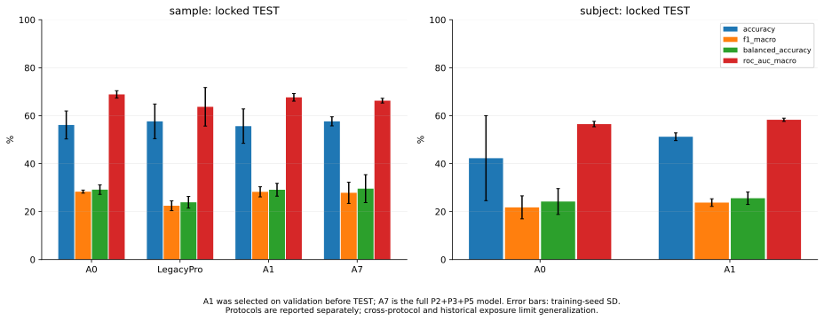
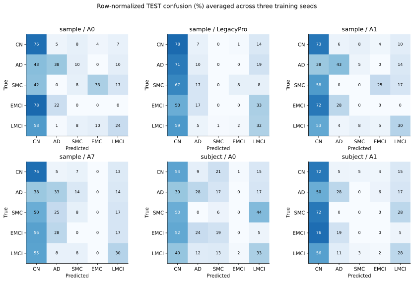
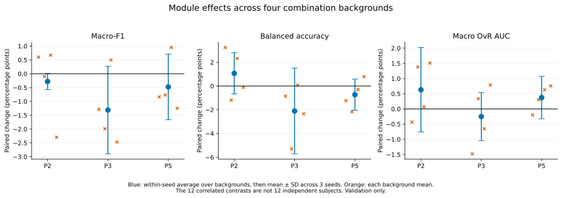

# ADNI_1–7 P2/P3/P5 完整研究报告

状态：研究范围内训练、消融、冻结测试及逐预测复算已完成。没有证据支持“三个稳定有效优化方向”或新版全面超过 BrainPrompt。完整新版 A7 是 P2+P3+P5；A1 只是由主验证集选出的 P2 候选，不能将 A1 改名冒充三模块新版。

## 1. 合成数据与协议

ADNI_1→ADNI_7 按既定采集清单拼接；一次有效 rs-fMRI acquisition 对应一个 AAL116 FC。复用清洗时序统一计算经验 Pearson，保留符号、ROI顺序、对称性和float32。逐扫描身份、时序和FC内容核对后未发现纳入样本重复；不同访视和不同日期的有效采集保留。划分前不另做随机重排，由冻结分层划分器处理，split seed1729。MCI→LMCI，类别顺序CN/AD/SMC/EMCI/LMCI；下载CSV Group为既定来源，来源冲突未擅自重新裁决。

1323个FC、895位生物学受试者，CN850/AD65/SMC39/EMCI61/LMCI308；AD为65个FC（4.913%），非AD为1258个FC（95.087%）。65不是AD患者人数。各批FC为200/198/200/200/200/198/127；AD FC为4/4/11/7/15/10/14。CSV的8/8/22/14条AD影像行不能直接当功能扫描数，其中包含配对结构影像。两项ADNI_2原扫描缺可信映射、两项ADNI_6预处理失败均保留排除证据，没有填造FC。完整各类别/QC/版本见[数据审计](DATA_AUDIT.md)。

模型共同输入为FC、ROI语义、受试者描述及全部五类疾病语义；P2/P3/P5按开关处理相应输入。Source_Dataset不用于预测，样本标识仅作reference自排除。历史site字段的采集含义尚未独立确认。

主协议是冻结sample-level 80/10/10 holdout，三种训练seed42/3407/2026共享同一划分。subject-disjoint是单独冻结的补充协议，只比较预先选定A1与A0，不合并指标。每个协议内部TRAIN/VAL/TEST用途受约束；sample协议仍存在同人跨划分。两个协议之间另有样本角色交叉，历史五批开发也曾使用部分样本，不能宣称全项目从未使用的独立外部测试。详见[协议](../../DATA_PROTOCOL.md)、D022及服务器私有交叉审计。

## 2. 训练、选择和冻结

使用共同Adam lr5e-5、weight decay .005、batch20、Dropout .5、clip5；最多400轮，验证无改善patience100/min120，LR下降patience25/factor.5，LR<1e-6也可停止。共同损失是两个TRAIN计数平方根逆频率加权CE，疾病辅助系数1；P2按spec增加0.1重建和0.1一致性。新runner未使用旧配置遗留graph sparse项。预训练40轮额外成本单列。

按验证Macro-F1、固定平局规则及loss选择checkpoint；**本轮不是早期十折最后一轮协议**。选择规则与实际已运行代码一致。完成19方法×3seed主比较、4项单seed微调探索、10项预训练、A0/A1各3seed的subject补充。主协议61份和补充6份验证结果均核验。P2预训练探索及失败结果完整保留。

A1在测试前由A0–A7三seed平均验证Macro-F1选择，验证35.63%(A0)→36.24%(A1)仅+0.60个百分点，三项其他指标下降。规则在观察验证结果后声明，不能倒称训练前预注册；subject结果不用于重选主要候选。固定测试范围为主19方法×3及补充2方法×3，共63项。checkpoint/source/dataset/split/evaluator与选择记录在selection_lock中绑定；全部只执行一次TEST。测试后不改模型、阈值、checkpoint或候选。

第一次控制器在写锁前因混合队列schema失败，零TEST访问；D023修复后以39ee2f2快照在GPU0/3/6恢复，原失败日志和fe8bf25副本保留。2026-10-11T11:21:28Z完成63/63。evaluator代码SHA保持1afa6d0446674a1a4744ac68a9799af7a3538cf4a1124f81d109943e79677334。随后逐一对齐预测身份与冻结标签，用计数公式独立复算P/R/F1/Accuracy，并核对概率AUC、混淆矩阵、每类指标、种子均值/SD；63份通过。此复核没有重跑模型。

## 3. 完整主协议测试结果

单位%，均值±三个训练seed的样本SD。P/R/F1均为固定五类macro；AUC为概率macro OvR。Balanced Accuracy与本数据的Macro-Recall相同。SD衡量训练随机性，不是患者置信区间或显著性检验。所有方法列出，没有按测试高低筛选。

| 方法 | Accuracy | Macro-F1 | Macro-Precision | Macro-Recall / BalAcc | Macro OvR AUC |
|---|---:|---:|---:|---:|---:|
| A0 BrainPrompt | 56.14 ± 5.84 | 28.33 ± 0.65 | 31.19 ± 3.70 | 29.15 ± 1.98 | 68.88 ± 1.54 |
| LegacyPro 旧版 | 57.64 ± 7.22 | 22.45 ± 2.05 | 22.38 ± 2.99 | 23.89 ± 2.42 | 63.71 ± 8.03 |
| A1 P2（预先选定候选） | 55.64 ± 7.17 | 28.25 ± 2.11 | 30.10 ± 2.99 | 29.10 ± 2.68 | 67.65 ± 1.58 |
| A2 P3 | 58.15 ± 3.86 | 25.91 ± 7.43 | 28.19 ± 7.43 | 28.15 ± 9.47 | 67.96 ± 1.80 |
| A3 P5 | 56.64 ± 4.14 | 27.75 ± 2.30 | 31.44 ± 0.23 | 28.57 ± 3.87 | 68.53 ± 1.43 |
| A4 P2+P3 | 58.15 ± 3.86 | 30.49 ± 2.40 | 32.77 ± 3.76 | 31.06 ± 4.50 | 68.36 ± 0.35 |
| A5 P2+P5 | 52.63 ± 5.21 | 27.50 ± 2.46 | 29.55 ± 2.38 | 29.86 ± 2.99 | 66.87 ± 0.63 |
| A6 P3+P5 | 55.39 ± 5.54 | 27.22 ± 0.49 | 28.21 ± 0.32 | 27.50 ± 0.45 | 66.89 ± 1.43 |
| A7 新版完整 P2+P3+P5 | 57.64 ± 1.89 | 27.84 ± 4.43 | 28.61 ± 3.10 | 29.57 ± 5.83 | 66.27 ± 0.97 |
| HistoricalM2 | 63.16 ± 3.45 | 30.57 ± 2.06 | 36.09 ± 2.78 | 30.06 ± 1.96 | 68.80 ± 1.62 |
| HistoricalM3v3 | 58.40 ± 2.85 | 28.04 ± 2.26 | 31.95 ± 2.43 | 27.26 ± 2.77 | 68.38 ± 0.74 |
| HistoricalM3v3_no_metadata | 59.40 ± 4.93 | 28.84 ± 2.25 | 33.28 ± 2.38 | 30.04 ± 3.36 | 69.07 ± 1.30 |
| P2_joint_cons_only | 56.39 ± 6.02 | 28.32 ± 0.59 | 30.74 ± 1.16 | 28.81 ± 1.03 | 68.05 ± 1.22 |
| P2_joint_rec_only | 55.64 ± 4.19 | 26.69 ± 4.62 | 28.25 ± 4.08 | 27.82 ± 3.44 | 66.48 ± 1.53 |
| P3_learned_query | 51.38 ± 11.31 | 26.28 ± 1.49 | 32.83 ± 9.79 | 28.18 ± 0.81 | 67.24 ± 2.80 |
| P3_parameter_matched | 55.64 ± 3.01 | 29.69 ± 4.44 | 35.91 ± 3.42 | 29.45 ± 4.56 | 66.90 ± 0.91 |
| P3_random | 57.39 ± 5.12 | 30.18 ± 2.37 | 33.92 ± 1.38 | 29.73 ± 4.61 | 69.74 ± 1.91 |
| P5_fixed | 56.14 ± 2.64 | 28.67 ± 1.03 | 30.45 ± 1.71 | 29.59 ± 2.00 | 68.07 ± 1.94 |
| P5_no_reliability | 57.89 ± 0.75 | 28.41 ± 1.38 | 32.10 ± 1.58 | 28.25 ± 1.55 | 68.50 ± 2.38 |

完整验证表见[Validation_Results](validation_complete/Validation_Results.md)，逐seed/逐类和Weighted-F1见[匿名测试JSON](final_test/test_summary.public.json)。四项单seed微调属于预先终止的验证探索，不混入本表，不是缺失三seed正式结果。

## 4. 受试者隔离补充

| 方法 | Accuracy | Macro-F1 | Macro-Precision | Macro-Recall / BalAcc | Macro OvR AUC |
|---|---:|---:|---:|---:|---:|
| A0 BrainPrompt | 42.28 ± 17.72 | 21.77 ± 4.80 | 23.55 ± 1.75 | 24.20 ± 5.38 | 56.50 ± 1.14 |
| A1 P2（预先选定候选） | 51.22 ± 1.63 | 23.75 ± 1.59 | 23.52 ± 1.42 | 25.58 ± 2.60 | 58.29 ± 0.68 |

A1相对A0的测试Macro-F1为+1.99±3.23个百分点、Accuracy为+8.94±17.61，但Macro-Precision为−0.03±0.33，Macro-F1也不是三个seed都提高。两者AD Recall均27.78%，EMCI Recall均0；主要改善不是AD召回提升。该补充支持有限的待验证信号，不支持全面提升或稳定泛化。主/补充测试样本不同，不能把两表差值全归因同人重叠，也不能合并为六seed或独立外部证据。

## 5. 对新版与类别失衡的判断

A7相对BrainPrompt：Accuracy+1.50、Macro-F1−0.49、Precision−2.58、Recall+0.42、AUC−2.61个百分点。A7相对旧Pro：Accuracy相同，F1+5.39、Precision+6.23、Recall+5.68、AUC+2.56，但配对seed差异不稳定（特别是AUC）。因此既不能说五项全面提升，也不能把超越较弱旧Pro等同于超越BrainPrompt。

A1主测试五项均值均未超过A0：Accuracy−0.50、F1−0.08、Precision−1.09、Recall−0.05、AUC−1.23个百分点。两个seed F1提高、一个下降，平均验证收益没有在主holdout确认。某些固定对照在测试表分数较高也不能用于重新挑冠军；本研究没有据test选择A4、HistoricalM2或random语义对照。

63份测试无“全部预测同一类”的整体塌缩；但少数类严重失效仍在。主协议A0/A1/A7的CN预测比例为68.92/65.66/67.42%，AD Recall为38.10/42.86/33.33%，EMCI Recall均0%。A1的SMC Recall也为0；A7三seed平均SMC Recall8.33%。这说明解除全CN行为不等于已解决五分类。典型错误是AD/LMCI被判为CN，以及EMCI被判为CN或AD；匿名行归一化矩阵如下，原始计数及逐例失败样本保留受控目录。

主测试恒预测CN的Accuracy可达63.91%，但Macro-F1仅15.60%、Balanced Accuracy20%；因此Accuracy低于多数类基线不等于模型毫无非CN信息，也不能用较高Accuracy掩盖少数类漏判。当前AUC与硬分类F1差异表明概率排序能力与五类argmax判别并不等价；没有据测试集调整阈值。

七批AD FC比例由历史五批41/998=4.108%增至65/1323=4.913%，约+0.805个百分点。新增ADNI_6/7分别为5.051%和11.024%，仍不能消除整体CN占优。没有只改变AD比例、保持人群/划分/训练其余条件不变的受控实验，不能把任何性能变化因果归于AD比例。历史五批与本轮七批不可直接比较涨幅；本轮三方法共用同一合成分布，本身不能估计比例变化效应。

## 6. 三模块验收、贡献和负面交互

| 用户要求回答的问题 | 基于实际证据的回答 |
|---|---|
| P2是否改善FC鲁棒性 | 未证明全面改善。三seed clean/5%/10%/15%扰动中只有部分强度有优势；固定last40预训练重建改善没有转成分类收益。 |
| P3是否提升疾病相关ROI提取 | token有差异且五类头有梯度，但不等于疾病相关性。验证F1不优于A0/近参数对照，主测试semantic F1低于random/参数对照，语义特异收益未成立。 |
| P5是否优于固定图 | 未证明。验证F1 A3=34.80%、fixed=36.06%；测试27.75%对28.67%。去可靠性对照测试28.41%。 |
| 三模块是否超过BrainPrompt | 否，A7验证/测试F1均低于A0，测试AUC也低。 |
| 哪个贡献最大 | P2的单模块验证F1变化+0.60pp是三者中最大，但四背景平均为负，主测试未确认；没有稳定正贡献的获胜模块。 |
| 哪些存在负面交互 | P3加入P2背景时F1−1.99pp，加入P2+P5时−2.47pp；P2加入P3+P5时−2.30pp。三阶F1交互−2.27±5.19pp，仅描述性证据，非显著性证明。 |
| 类别失衡造成哪些现象 | CN高占比支撑Accuracy与Weighted-F1，掩盖SMC/EMCI低召回；不能把全部机制失败单独归因失衡。 |
| 是否多数类塌缩 | 没有全单类预测，但多个模型EMCI Recall为0、A1 SMC为0，存在类别识别失败。 |
| 是否标签泄漏/同人关联 | 未发现将真实label用于疾病query选择；P5 TRAIN成员、自排除、版本验证通过。但sample同人跨split、协议间角色交叉及历史开发暴露真实存在，不能称完全无泄漏风险。 |
| 最终保留哪些模块 | 没有一个模块达到稳定泛化增益的证据要求，拒绝三创新成功结论。保留A0比较基线、A1预先选定研究候选和A7完整实现/负面结果；不将候选称为已验证升级。 |

P2/P3/P5的验证四背景平均F1边际分别−0.28±0.29、−1.31±1.58、−0.48±1.19个百分点。配对差先在每seed内平均四背景，再跨三seed计算SD，不能当12份独立数据。[完整配对消融](validation_complete/Ablation_Effects.md)。

## 7. 原因、成本与方法边界

P2初始重建接近均值/饱和；修订解码与预训练Dropout后数值目标可改善，但疾病判别没有随之改善，说明重建任务与标签目标不等价。P3有可训练语义读出却未击败参数/语义对照，不能仅用注意力可视化作为有效机制证明。P5参考编码器固定、reliability约0.96、边权近均匀、残差约融合表示范数0.29%、边打分梯度很小，是当前学习关系弱作用的直接证据。完整A7的附加目标和分支并未形成正消融收益；不能把工程检查通过等同于性能成功。小样本、多类不均衡、来源/站点关联及验证集探索选择共同限制结论，无法用本轮数据单独确定各因素的因果份额。

A0/A1/A7总参数为818095/835264/1817814；训练循环均值约6.67/18.13/70.16分钟。P5总参数包含冻结teacher，运行时间不含初始bank构建；共享GPU使这些不是严格效率benchmark。[类别与成本](final_test/Final_Analysis.md)。A7成本增加而主要指标未提升，现有证据不足以支持其作为优于基线的最终方案。

公式、形状、损失、复杂度、实现路径、历史M2/M3复用与ncomms启发见[技术报告](Technical_Report.md)及[METHOD_AUDIT](METHOD_AUDIT.md)。BrainPrompt+频谱/空间语言提示和五提示语义图已排除，未复制ncomms AGPL实现；并不因此宣称领域首创。

## 8. 已完成、缺失与下一步

已完成全部登记的主三seed矩阵、关键对照、补充A0/A1、有限预训练探索、机制探针、一次63项冻结测试与独立复算。代码、配置、匿名表格、SVG图及复現规则接入独立研究分支；原项目/五批历史锁不变。当前没有本研究仍在运行的训练或评估任务。四种预训练微调按预先决策只做seed42，未扩成三seed；subject补充没有扩展全部19方法，二者均是明确范围，不冒称完成了未运行实验。

研究性能目标未达到，缺少独立外部队列及稳定正消融证据。旧五批锁定TEST仍未运行，属于历史路线，不冒用七批结果补齐。下一步首先审阅本报告与PR；如另行开展改进，需建立新的、按受试者隔离且未参与现有开发的评估范围，并在TEST封存前锁定研究方案。本轮TEST已使用，禁止在同一测试集上继续调参或以其排名重选模块。

恢复证据：N/queues/phase8_frozen_test（保留的pre-lock失败）；N/queues/phase8_frozen_test_recovery_20261011（63/63完成）；N/reports/final_analysis_20261011/audit.private.json（逐预测复核）。N定义见[RUNBOOK](RUNBOOK.md)。只复算已有预测时可使用report_final并指定新的私有输出目录；不得再次运行已完成的finalize_study。

最终锁SHA256：`fb71040c47d235b382dac5f487b01ff9f925d262f305f134254a67250bc63031`。模型训练源码主要为29f34f9，早期运行各自source_sha256保留；控制器恢复快照39ee2f2。逐seed训练版本/配置/停止轮/checkpoint SHA在验证JSON与私有run目录；不能把后续报告提交SHA写成原训练版本。
